<h1 align="center">szkoly-mcp 🏫</h1>

<p align="center">
  <b>Szkoły, przedszkola i wyniki egzaminów w Polsce – dla Twojego asystenta AI.</b><br>
  Serwer <a href="https://modelcontextprotocol.io">MCP</a> z oficjalnym wykazem szkół i przedszkoli (MEN, SIO) oraz wynikami egzaminu ósmoklasisty i matury dla każdej szkoły (CKE). Działa w Claude, ChatGPT, Cursorze i każdym kliencie MCP.
</p>

<p align="center">
  <a href="https://www.npmjs.com/package/szkoly-mcp"></a>
  <a href="https://github.com/ContentWriterco/szkoly-mcp/actions/workflows/ci.yml"></a>
  <a href="LICENSE"></a>
  
</p>

<p align="center">
  
</p>
<p align="center"><sub>Prawdziwa odpowiedź publicznego serwera (egzamin ósmoklasisty 2026).</sub></p>

## Podłącz w 30 sekund

Adres MCP: **`https://szkoly.compabase.com/mcp`** (Streamable HTTP, bez logowania).

- **Claude:** Ustawienia → Connectors → *Add custom connector* → wklej adres.
- **ChatGPT:** Settings → Connectors (tryb deweloperski) → dodaj serwer MCP.
- **Claude Code:** `claude mcp add --transport http szkoly https://szkoly.compabase.com/mcp`
- **Lokalnie (stdio):** `npx -y szkoly-mcp`, np. w Claude Desktop:

```json
{ "mcpServers": { "szkoly": { "command": "npx", "args": ["-y", "szkoly-mcp"] } } }
```

## Co potrafi

| Narzędzie | Do czego |
|---|---|
| `find_schools` | Szkoły albo przedszkola w miejscowości, gminie lub **najbliżej adresu** (z odległością): typ, publiczna/niepubliczna, specyfika (np. specjalna, sportowa), adres, **liczba uczniów**, strona www, numer RSPO i **najnowsze wyniki egzaminu** na tle Polski – egzamin ósmoklasisty dla podstawówek, zdawalność i średnie z matury dla liceów i techników. Sortowanie po odległości, wynikach albo nazwie; filtr „tylko publiczne”. |
| `school_details` | Jedna szkoła (po numerze RSPO albo nazwie): dane z rejestru, organ prowadzący, liczba uczniów i nauczycieli, **wyniki z ostatnich 3 lat z każdego przedmiotu** na tle powiatu i kraju – egzamin ósmoklasisty albo matura (zdawalność, przedmioty podstawowe i rozszerzone). |
| `data_sources` | Źródła, roczniki danych i zastrzeżenia. |

**Przykładowe pytania:** „Jakie podstawówki są najbliżej ul. Garbary 10 w Poznaniu?”, „Najlepsze licea w Poznaniu wg matury”, „Porównaj SP 1 i SP 2 w Kórniku”, „Jakie przedszkola są w gminie Swarzędz?”, „Jak technikum w Bolesławcu wypada z matematyki na maturze?”.

## Skąd dane

- **Wykaz szkół i placówek oświatowych** – MEN, System Informacji Oświatowej (stan na 30 września), dane.gov.pl, CC BY 4.0: ok. 42 tys. szkół i przedszkoli z adresem, typem, organem prowadzącym, liczbą uczniów i nauczycieli.
- **Wyniki egzaminów** – Centralna Komisja Egzaminacyjna, [Mapa wyników egzaminów](https://mapa.wyniki.edu.pl): egzamin ósmoklasisty i matura (formuła 2023) z ostatnich 3 lat, dla każdej szkoły (średnie pokazywane od 5 zdających). Średnie powiatu i kraju liczymy z wyników szkół (ważone liczbą zdających).
- **Odległości** – adresy szkół geokodowane państwowym rejestrem adresów GUGiK.
- Dane pobierają się przy pierwszym uruchomieniu (~35 MB plików źródłowych, zapisywane jako ~35 MB JSON w `~/.cache/szkoly-mcp`) i są sprawdzane raz na dobę.
- **Zastrzeżenia:** wynik egzaminu zależy w dużej mierze od tego, jacy uczniowie trafiają do szkoły, i nie mierzy wszystkiego, co w niej ważne. O przyjęciu do szkoły podstawowej decyduje obwód (rejon) ustalony przez gminę.

## Własny serwer

```bash
npx -y szkoly-mcp --http --port 3000      # MCP: http://localhost:3000/mcp
npx -y szkoly-mcp find "Kórnik" --level podstawowa
npx -y szkoly-mcp school 70077
```

Zmienne: `SZKOLY_DATA_DIR`, `SZKOLY_REFRESH_HOURS` (24), `SZKOLY_E8_YEARS` / `SZKOLY_MATURA_YEARS` (3), `SZKOLY_RATE_LIMIT`, `SZKOLY_STATS=1` (anonimowe liczniki pod `/stats`), `SZKOLY_CONTACT`, `SZKOLY_PUBLIC_URL`.

## Licencja

Kod: MIT. Dane: MEN (SIO, dane.gov.pl, CC BY 4.0), CKE (Mapa wyników egzaminów), GUGiK – dane przetworzone. Projekt niezależny, hostowany pro publico bono przez [Compabase](https://compabase.com). Zobacz też [rozkład-mcp](https://github.com/ContentWriterco/rozklad-mcp), [ceny-nieruchomosci-mcp](https://github.com/ContentWriterco/ceny-nieruchomosci-mcp), [leki-mcp](https://github.com/ContentWriterco/leki-mcp) i [powietrze-mcp](https://github.com/ContentWriterco/powietrze-mcp).

---

## English

<p align="center"></p>

**szkoly-mcp** gives AI assistants the **official register of Polish schools and kindergartens** (Ministry of Education, SIO) with pupils, teachers and addresses, plus **per-school exam results** – the eighth-grade exam (egzamin ósmoklasisty) and the matura – for the last three years by subject, compared with county and national averages. Find schools in a town, gmina or near an address (with distances). Public endpoint: `https://szkoly.compabase.com/mcp` (no key), or run locally with `npx -y szkoly-mcp`.
